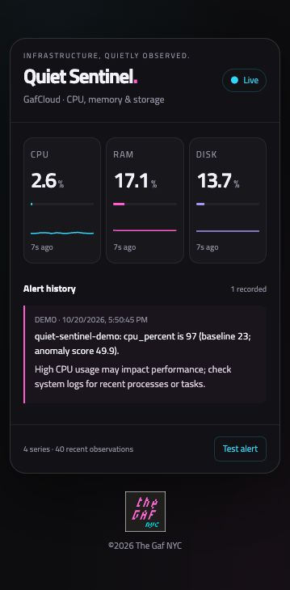

# Quiet Sentinel

A compact server monitor that learns ordinary behavior, suppresses repeated anomalies, and optionally explains alerts using your chosen AI provider. Built by [The Gaf NYC](https://gaf.nyc).



## What it does

- Receives measurements through a small HTTP API.
- Learns a rolling median/MAD baseline per host and metric.
- Ignores CPU deviations below 15 percentage points and suppresses repeated alerts for 15 minutes.
- Collects CPU, RAM and root disk utilization every 30 seconds on Linux.
- Shows recent metric histories and scrollable alert history in a responsive control panel.
- Explains alerts through Ollama or OpenAI; explanations are advisory and never execute commands.

Python 3.10+; no third-party Python packages required. Ollama is a separate optional service. No AI model is bundled or automatically downloaded.

## Start monitoring

From this directory:

```bash
python3 -m quiet_sentinel
```

Open http://127.0.0.1:8765. In a second terminal on the same Linux server:

```bash
python3 monitor.py
```

The collector needs Linux `/proc/stat` and `/proc/meminfo`. The dashboard and API can run on macOS, but this collector cannot. Five baseline samples are required before anomaly scoring. Early readings show learning in collector output; the dashboard's Live badge indicates recent readings, not baseline readiness.

## Connect AI: Ollama / open-weight models

Use an existing Ollama installation and installed model. Example:

```bash
python3 -m quiet_sentinel --ai --provider ollama --model qwen2.5:14b-instruct --ollama-url http://127.0.0.1:11434
```

The demonstrated open-weight setup uses Qwen 2.5 14B Instruct on a Mac, with the dashboard and collector on GafCloud. To reproduce that split privately, run this on the Mac (replace the SSH alias if necessary):

```bash
ssh -N -o ExitOnForwardFailure=yes -o ServerAliveInterval=30 -R 127.0.0.1:11435:127.0.0.1:11434 gafcloud
```

Then use `--ollama-url http://127.0.0.1:11435` on GafCloud. Keep the Mac awake, Ollama running and the tunnel open. Alternatively run Ollama on the monitoring server yourself. This project does not install it.

## Connect AI: OpenAI

Supply `OPENAI_API_KEY` through your server's secret store or service environment, then run:

```bash
python3 -m quiet_sentinel --ai --provider openai --model gpt-4.1-mini
```

OpenAI sends alert details and up to eight recent values to an external service and incurs separate API charges. The key stays on the server, is never returned in API state and must never be committed. Responses use `store: false`; this is not a claim of zero retention by the provider. An unavailable provider yields an explicit fallback explanation and monitoring continues. Inference is synchronous with a 60-second timeout and can delay that collector cycle.

The OpenAI integration has mocked regression coverage. The deployment test returned `credit_balance_exhausted`, so successful live OpenAI inference has **not** been demonstrated. The verified AI demo used Ollama/Qwen.

Provider settings are currently command-line flags or environment variables, not an in-panel connection wizard. Supported variables: `SENTINEL_PROVIDER`, `SENTINEL_MODEL`, `SENTINEL_OLLAMA_URL`, and `OPENAI_API_KEY`. `--ai` must be supplied to enable explanations.

## Demo and API

Click **Test alert** to send synthetic CPU samples under the separate `quiet-sentinel-demo` host. DEMO alerts do not replace GafCloud's live metric cards. Repeated tests can be suppressed by the same cooldown as real alerts.

```bash
curl http://127.0.0.1:8765/api/state
```

Send measurements with `POST /api/observe`, JSON body `{"host":"gafcloud","metric":"cpu_percent","value":42}` and `Content-Type: application/json`. Return states: `learning`, `normal`, `alert`, or `suppressed`.

## Automatic startup on Linux

Copy the sample units in `deploy/` into `~/.config/systemd/user/`. Change their working directory and model settings to match your installation. Put secrets in `~/.config/quiet-sentinel/ai.env` with mode 600; omit the optional environment file for Ollama. Then enable the dashboard and collector with your user service manager. User services need lingering enabled to start at boot and survive logout. Do not start a second manual collector or dashboard on the same port.

The samples assume an install at `~/quiet-sentinel/quiet-sentinel`. The Mac SSH tunnel is not managed by these units.

## Tests

```bash
python3 -m unittest discover -s tests -v
```

Tests cover baseline behavior, host isolation, the CPU noise guard, cooldown suppression, provider response parsing and failure handling without making paid API calls.

## Prototype boundaries

- State exists only in memory; restarting clears baselines and alert history.
- No authentication, persistence, email/push delivery or production hardening.
- Bind to localhost and access privately; do not expose this API to the public internet.
- Snapshot returns the latest 40 observations and up to 100 alerts, not a durable audit log.
- Detector choices are heuristics, not guarantees of incident detection. AI explanations may be wrong.
- No Arduino integration is implemented or claimed.

## Challenge disclosure

Prepared for the Hacktoberfest Open-Source AI Challenge Week 3: Slow and Steady. Open-weight Qwen through Ollama was tested; OpenAI is an optional alternative, not the basis for the open-source AI demonstration. No measured time-saving claims or partner-prize claims are made. Built with AI coding assistance; implementation and live behavior were tested. Contest eligibility is determined by organizers.

## License

Source code: MIT, see LICENSE. Embedded The Gaf branding identifies this project and is not a grant to use that identity for unrelated products. Model licenses and provider terms apply separately.
